<!-- Graphics in assets/ are generated by src/build.py. Edit there and re-run. -->

<a href="https://vidhux.dev">
<picture>
  <source media="(prefers-color-scheme: dark)" srcset="assets/hero-dark.svg">
  
</picture>
</a>

<p align="center">
  <a href="https://vidhux.dev"><b>vidhux.dev</b></a> &nbsp;·&nbsp;
  <a href="https://vidhux.dev/kernel">kernel log</a> &nbsp;·&nbsp;
  <a href="https://blog.vidhux.dev">blog</a> &nbsp;·&nbsp;
  <a href="https://linkedin.com/in/vidhusarwal">linkedin</a> &nbsp;·&nbsp;
  <a href="https://x.com/vidhu_sarwal">x</a> &nbsp;·&nbsp;
  <a href="mailto:vidhu.sarwal19@gmail.com">email</a>
</p>

<br>

<picture>
  <source media="(prefers-color-scheme: dark)" srcset="assets/s-now-dark.svg">
  
</picture>

- **Writing an upstream IIO driver** for the Benewake TF-Luna LiDAR, brought up on a Raspberry Pi 4 over I²C, including the parts the datasheet leaves out.
- **Fixing bugs in mainline Linux** as a Linux Foundation kernel mentee: runtime-PM refcount leaks, IIO value encoding, a syzbot crash in ntfs3.
- **Shipping [wiremark](https://github.com/VidhuSarwal/wiremark)**, an eBPF tracer that records what your app really sent to Redis, then replays it with Redis switched off.
- **Finishing a CS degree.** Final year.

<br>

<picture>
  <source media="(prefers-color-scheme: dark)" srcset="assets/s-upstream-dark.svg">
  
</picture>

Seven patches merged into mainline so far, mostly in IIO. Every one is on lore.kernel.org.

- `merged` [iio: light: al3010: fix incorrect scale for the highest gain range](https://lore.kernel.org/all/20260704115245.11167-1-vidhu.linux@gmail.com/) <sub>v7.2 · Cc stable</sub>
- `merged` [staging: media: ipu7: fix pm_runtime refcount leak in ipu7_resume()](https://lore.kernel.org/all/20260704083031.8524-3-vidhu.linux@gmail.com/) <sub>+1 sibling fix</sub>
- `merged` [iio: light: ltrf216a: fix runtime PM reference leak in error path](https://lore.kernel.org/all/20260713022829.234370-1-vidhu.linux@gmail.com/)
- `merged` [iio: light: opt4060: Reject integration times with a non-zero seconds part](https://lore.kernel.org/all/20260715011544.281148-1-vidhu.linux@gmail.com/) <sub>+2 in the series · Cc stable</sub>
- `rfc   ` [fs/ntfs3: fix positive E_NTFS_NONRESIDENT leaking into writeback error path](https://lore.kernel.org/all/20260713084140.249515-1-vidhu.linux@gmail.com/) <sub>syzbot crash</sub>

<sub>The full log, with a plain-English note on every patch, is at <a href="https://vidhux.dev/lore"><b>vidhux.dev/lore</b></a>.</sub>

<br>

<picture>
  <source media="(prefers-color-scheme: dark)" srcset="assets/s-work-dark.svg">
  
</picture>

**[wiremark](https://github.com/VidhuSarwal/wiremark)** &nbsp;<sub>`Go` `eBPF` &nbsp;·&nbsp; v0.2.0 &nbsp;·&nbsp; [wiremark.vidhux.dev](https://wiremark.vidhux.dev)</sub>  
Watches a running process from inside the kernel, captures a real HTTP request and the Redis calls behind it, and turns them into a fixture you can replay later without Redis.

**[shardX](https://github.com/VidhuSarwal/shardX)** &nbsp;<sub>`Go` `React` `AWS` `Terraform`</sub>  
Zero-knowledge object storage. Uploads become ChaCha20 noise split into shards on S3 under KMS. The server never holds the key, so a full bucket-and-database compromise yields nothing readable.

**[tactile-sight](https://github.com/VidhuSarwal/tactile-sight)** &nbsp;<sub>`Python` `Arduino UNO Q` `STM32`</sub>  
A depth camera wired to a vibration band for the visually impaired. Each depth frame becomes a 7×3 haptic grid that the on-board STM32 plays on the band's motors over I²C.

**[GSoC '25 · BeagleBoard.org](https://gist.github.com/VidhuSarwal/8e8d9dd93fea9075428cc6320c3b0a4f)** &nbsp;<sub>`C` `I²C` `Buildroot` `MQTT` &nbsp;·&nbsp; [beagle-tester](https://github.com/VidhuSarwal/beagle-tester)</sub>  
Hardware test tooling for BeagleBoard designs: I²C bus scan, EEPROM dispatch, mikroBUS ClickID auto-detection and OpenCV HDMI validation, with a Buildroot cross-compiled CI.

**[GitScope](https://github.com/VidhuSarwal/gitscope)** &nbsp;<sub>`Python` `Tree-sitter` `ChromaDB` &nbsp;·&nbsp; [live](https://gitscope-nine.vercel.app)</sub>  
Turns a GitHub repo into a readable story: per-function breakdowns from the Tree-sitter AST, semantic search, and LLM summaries of how the code evolved.

<br>

<picture>
  <source media="(prefers-color-scheme: dark)" srcset="assets/s-experience-dark.svg">
  
</picture>

**Kernel Developer Mentee** · Linux Foundation, LFX Mentorship &emsp;<sub>`2026 – now`</sub>  
Bug triage and fixes in mainline under maintainer mentorship.

**Research Intern, AI Infrastructure** · Samsung R&D, PRISM &emsp;<sub>`2025 – 2026`</sub>  
Sole owner of a 61k-line async Python platform: LangGraph agents, hybrid BM25 + ChromaDB retrieval, Qwen-VL document parsing. Cut end-to-end latency 70%. Adopted by several teams as an internal NotebookLM replacement.

**Software Engineering Intern** · Google Summer of Code, BeagleBoard.org &emsp;<sub>`2025`</sub>  
Selected from 40,000+ applicants. Linux-hosted hardware testing in C and C++, with a 30% performance improvement.

**Engineering Intern, Embedded** · Sentinal Innovations &emsp;<sub>`2024`</sub>  
ESP32 firmware for an IoT relay system, shipped to 50+ homes and cutting their energy use 25%.

**Smart India Hackathon** · National winner, team lead &emsp;<sub>`2024`</sub>  
Led the team that built an AI expert-recommendation engine. National winner among 10,000+ participants.

<br>

<picture>
  <source media="(prefers-color-scheme: dark)" srcset="assets/s-toolchain-dark.svg">
  
</picture>

```text
systems      C · C++ · Go · Rust · Bash
kernel       IIO · runtime PM · device tree · eBPF · patch workflow
embedded     ESP32 · STM32 · I²C · SPI · UART · MQTT · FreeRTOS · Buildroot
backend      Python · FastAPI · PostgreSQL · Redis · Docker · AWS · Terraform
ai / ml      LangGraph · ChromaDB · Tree-sitter · Qwen-VL · RAG
```

<br>

<picture>
  <source media="(prefers-color-scheme: dark)" srcset="assets/s-maintainers-dark.svg">
  
</picture>

```text
VIDHU SARWAL
M:	Vidhu Sarwal <vidhu.linux@gmail.com>
S:	Maintained
W:	https://vidhux.dev
W:	https://blog.vidhux.dev
T:	git https://github.com/VidhuSarwal
F:	hardware/
F:	linux/
F:	distributed-systems/
F:	llms/
```

<sub>Happy to talk kernel, embedded or infrastructure work. <a href="mailto:vidhu.sarwal19@gmail.com">Email</a> is the fastest way to reach me.</sub>

<br>

<a href="https://vidhux.dev">
<picture>
  <source media="(prefers-color-scheme: dark)" srcset="assets/footer-dark.svg">
  
</picture>
</a>
